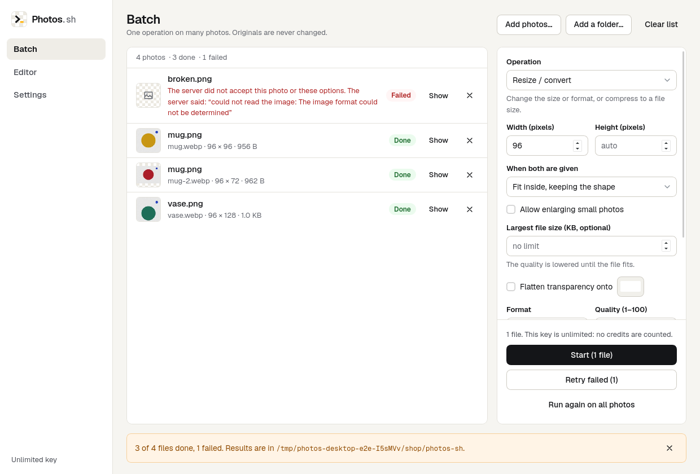
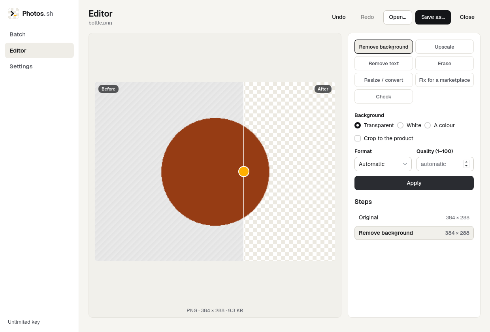

# Photos.sh desktop

A desktop app for [Photos.sh](https://photos.sh): process product photos by
the folder, or edit one photo tool by tool, with the Photos.sh API. For
Linux, macOS and Windows.



## What it does

**Batch.** Drop photos or whole folders on the window (or pick them), choose
one operation, and start:

- remove background (with a choice of model: Atlas, Lumen or Muse; a
  shadow under the product, if you want one; for a studio shot, keeping the
  box or lid shown with the product; three controls for the cutout's edge),
  upscale, remove text, resize / convert / compress, fix for a marketplace
  (Amazon, eBay, Etsy, ...), run a preset, or a recipe of your own (below);
- enhance (light and colour: automatic, or your own brightness, contrast,
  saturation and sharpening), denoise, colourise a black-and-white photo,
  restore faces, hide faces (blurred, pixelated or covered);
- crop to a shape (1:1, 4:5, 16:9, ...) around the subject or the faces,
  expand to a shape (the new area continues the photo, or is white), add a
  text watermark, or vectorize (the result is an SVG file);
- results go to a folder you choose: by default a `photos-sh` folder beside
  the first photo. Each result is named after its source, with the extension
  of the type the service returned (`shoe.jpg` → `shoe.png`);
- **originals are never changed, and no file is ever overwritten**: when a
  name is taken, the new file gets a number (`shoe-2.png`);
- before it starts, you see what the batch costs in credits and what is
  left. A batch the balance cannot pay for does not start;
- a few files are processed at once (3 by default), with a status per file,
  overall progress, **Cancel** (immediate) and **Retry failed**. A file that fails is
  marked with the reason and the batch goes on; running out of credits or a
  refused key stops the batch;
- each finished file can be shown in the file manager.

**Editor.** Open or drop one photo and apply tools one after another:

- remove background (with a choice of model and the edge controls,
  transparent or on a colour), upscale, remove text,
  erase (paint over an object with a brush), select object (click an object
  to cut it out), enhance, denoise, colourise, restore faces, hide faces,
  crop to a shape, expand, resize / convert, watermark, fix for a
  marketplace, a recipe, and check (quality findings and, with a marketplace,
  its verdict);
- each tool works on the result of the one before. Undo and redo move
  through the steps; a before/after slider compares with the original;
  transparency is shown on a checkerboard;
- **Save as** writes the current step. The original is replaced only when
  you pick its own path and confirm a second time.

**Recipes.** In the batch and the editor, *Recipe* runs several steps on one
upload, as one request charged as one: read the barcodes and the text, remove
text, upscale a small photo, remove the background (with a choice of model,
a studio shot and the edge controls), place the product on a
canvas of a set size or crop close around it, add a shadow and a background
(white, a colour, a gradient or the photo's own, blurred), and set the size,
format and file size. The steps always run in that order. Barcodes and text
are read off the photo before anything changes it: the editor shows what was
read beside the picture, with *Copy*; in the batch, each file's line says it.



**Settings.** Your API key (paste, test, remove), the account and its
credits, how many files are processed at once, the default output format,
and (advanced) the API's base URL.

### Good to know

- Folders are searched with their subfolders for JPEG, PNG, WebP, GIF, TIFF,
  BMP, HEIC/HEIF and AVIF files. Hidden files and folders are skipped, and
  so are folders named `photos-sh` (they hold earlier results).
- **Cancel** stops a batch at once. The requests for the photos being
  processed are dropped, nothing is saved for them, and they are marked
  *Cancelled*; photos not yet started are marked *Not run*; photos already
  finished stay done. **Retry** runs the cancelled and not-run ones again
  with the same operation. Cancelling a running tool in the editor works the
  same way and leaves the steps as they were.
- What a cancelled photo costs: the service counts a request only when it
  has answered it, and drops a request whose connection has closed, so a
  cancelled photo is normally not charged. The service cannot stop work it
  has begun, though, and an answer that was already on its way when you
  cancelled is counted. The app says so when you cancel; the balance in
  Settings is the truth.
- An error that stops a batch (no credits, a refused key) is different: the
  photos in progress are left to finish.
- Every file is one request and costs what the account's price list says
  per photo. Only successful requests are charged. A tool the price list
  does not name is free, and the cost line says so.
- Some tools say what they found, on the file's line in a batch and under
  the picture in the editor: how many faces were hidden or restored (and how
  many were left alone for being large and detailed already), that a crop
  found nothing to build around and is centred, that remove background
  found no subject ("No subject found: nothing was cut out", and the result
  is the photo as it was), how many paths an SVG has.
  **Hide faces** reports "No faces found: nothing was hidden" for a photo it
  returns as it was: small faces, and faces seen from behind or mostly
  covered, are not found, so look at that count before relying on a result.
  Only covering a face leaves nothing of it; blur and pixelation stop a
  person from recognising it.
- **Model** (an option of remove background, also in a recipe) is what
  finds the subject. Each costs the same; when one drops part of what you
  sell, try another.
  - **Atlas** (the default): everyday product photos, a product alone or
    with its box, on any backdrop.
  - **Lumen**: pale packaging on a light backdrop, such as a cream or wooden
    box beside a bottle (Atlas can keep the bottle and drop the box), and
    close-ups where the product fills the photo. It may keep a dark backdrop
    at the photo's edge, and can cut away part of an open frame or wire
    stand.
  - **Muse**: people, in portraits and as models wearing the product.

  With Atlas the app sends no `model`, so the service's default applies;
  otherwise it sends `model=lumen` or `model=muse`. Studio shot works with
  every model.
- **Studio shot** (an option of remove background) is for a product on a
  plain, light backdrop, as in a light tent. The cutout also keeps what
  clearly stands out from the backdrop and touches the product, such as the
  gift box, case or lid shown with a bottle, or a pale box that would
  otherwise come out half transparent. Shadows and the floor below the product are left
  out. A photo without a plain light backdrop is cut out as without the
  option. It is off by default.
- **Edge shift**, **Edge hardness** and **Edge smoothing** (options of remove
  background, also in a recipe) adjust the cutout's edge. Each is 0 by
  default, which changes nothing.
  - **Edge shift**, -10 to 10 pixels, moves the edge: inward when negative,
    outward when positive. -1 to -2 trims the light rim a dark product shows
    on a dark page.
  - **Edge hardness**, 0 to 100, makes the edge crisper: about a pixel wide
    at 100. On a dark page, pair it with a small negative shift.
  - **Edge smoothing**, 0 to 10, irons out ripples in the outline. From
    about 4 it rounds small corners and can break thin parts such as a wire
    stand.

  At 0 the app sends nothing for a control; otherwise it sends `shift`,
  `hardness` or `smooth`. A value outside its range is refused before
  anything is sent.
- Three tools can mislead, and say so beside their options. **Colourise**
  guesses its colours: skin, sky and grass come out believable, the colour
  of clothes or a car is invented. **Restore faces** invents the detail it
  adds, so it is not for identity photos or evidence. **Denoise** is slow
  when the server has no GPU (about half a minute per megapixel, and a
  request is given up after two minutes) and takes photos up to 12
  megapixels.
- **Expand** continues plain backgrounds (a backdrop, a table, sky). It does
  not invent content: a subject cut off at the photo's edge stays cut off.
  A side can grow by the photo's own width or height at most.
- **Watermark** text is drawn in Latin, Greek and Cyrillic letters; other
  scripts come out as empty boxes.
- **Vectorize** is for logos, icons and flat drawings; a photograph becomes
  thousands of paths and a large file. Its result is an SVG file, which the
  editor cannot use as a step, so it is offered in Batch only.
- **Select object** takes up to 32 clicks. A click can mean a part or the
  whole thing; you can ask for the smallest or the largest answer. On large
  photos its edges are softer than Remove background's.
- HEIC photos cannot be shown in the app (the system web view has no
  decoder), but they are processed like any other, and the results are
  shown. TIFF files are converted for display.
- The app talks to the Photos.sh API, and to GitHub to check for updates
  (which Settings can turn off), and to nothing else. There is no telemetry,
  and the web view inside the app is not allowed to make network requests
  at all.

## Install

Installers for each release are on the
[releases page](https://github.com/photos-sh/photos-desktop/releases):
AppImage, `.deb` and `.rpm` for Linux, a universal `.dmg` for macOS, and
`.msi` / setup `.exe` for Windows.

The builds are **not signed yet**, so the system will warn:

- **macOS:** right-click the app and choose *Open* the first time (or allow
  it under *System Settings → Privacy & Security*).
- **Windows:** in the SmartScreen dialog choose *More info → Run anyway*.
- **Linux:** needs WebKitGTK 4.1 (`libwebkit2gtk-4.1-0` on Debian/Ubuntu,
  `webkit2gtk4.1` on Fedora), which the `.deb` and `.rpm` pull in.

### Updates

When the app starts, it asks GitHub whether a newer release is out, and if
one is, offers it in a banner: *Install and restart* downloads it, checks its
signature and installs it. Nothing is downloaded until you choose to.
*Settings → Updates* checks by hand; *Settings → Preferences* turns the check
at start off. An update is not installed while a batch runs, and the app
restarts to finish it, so save a photo open in the editor first.

Every update is signed with the project's update key, and the app refuses one
whose signature does not match the public key it was built with. Updates
install the way the app was installed: the AppImage replaces itself, the
`.deb` and `.rpm` are installed with the system's package tool (it asks for
your password) when the release's `latest.json` lists a signed one for them,
and on Windows the setup `.exe` or `.msi` runs. If an update cannot be
installed, the banner links to the release page to download it.

Then open **Settings**, paste an API key from the Photos.sh console (your
organisation's *API keys* page), and press **Save and test**.

## How the API key is stored

The key is kept in the operating system's keychain: the macOS Keychain, the
Windows Credential Manager, or on Linux the Secret Service (GNOME Keyring,
KWallet, KeePassXC...), under the service `sh.photos.desktop`.

- It is never written to a settings file, never logged, and sent only to the
  API (`Authorization: Bearer ...`).
- The window never gets the key back once it is saved: it only learns that a
  key is set and its last four characters.
- If no keychain is available (for example a Linux session without a Secret
  Service), the app says so and keeps the key in memory until you quit. It
  does not fall back to a file.
- **Remove** in Settings deletes it from the keychain.

The other settings are in a small JSON file in the app's config folder
(`~/.config/sh.photos.desktop/settings.json` on Linux,
`~/Library/Application Support/sh.photos.desktop/` on macOS,
`%APPDATA%\sh.photos.desktop\` on Windows).

## Build from source

You need [Rust](https://rustup.rs) 1.90 or newer, [Node.js](https://nodejs.org)
22 or newer, and the system packages below. The Tauri CLI comes with
`npm install`.

**Debian / Ubuntu**

```sh
sudo apt install build-essential pkg-config libssl-dev \
  libwebkit2gtk-4.1-dev libgtk-3-dev libsoup-3.0-dev
# for installers (AppImage, deb, rpm) also:
sudo apt install librsvg2-dev patchelf file rpm
```

**Fedora**

```sh
sudo dnf install gcc pkgconf-pkg-config openssl-devel \
  webkit2gtk4.1-devel gtk3-devel libsoup3-devel
# for installers also:
sudo dnf install librsvg2-devel rpm-build patchelf
```

**macOS:** the Xcode command line tools (`xcode-select --install`).

**Windows:** the *Desktop development with C++* workload of the Visual
Studio Build Tools, and the WebView2 runtime (part of Windows 10 and 11).

Then:

```sh
npm install
npm run tauri -- build              # the app and its installers, in src-tauri/target/release/bundle/
npm run tauri -- build --no-bundle  # just the app: src-tauri/target/release/photos-desktop
```

## Development

```sh
npm run tauri dev    # the app, reloading as you edit
npm run dev:mock     # only the UI, in a browser, with the core faked: http://127.0.0.1:1420/
```

The fake core (`src/dev/mock.ts`) makes every view reachable without an
engine or a key; its header lists switches such as `?key=none` and
`?keychain=none`. It is not part of a normal build.

### Layout

```
src-tauri/                The Rust core
  src/api/                  the API client: requests, retries, errors, result types
  src/ops.rs                the operations and their query strings
  src/recipe.rs             a recipe of the user's: its rules, and the TOML sent to /v1/run
  src/batch/                the batch: file list, planning (which files, names, cost), the runner
  src/editor.rs             the editor's steps (temporary files, undo/redo, save as)
  src/mask.rs               the erase mask, drawn from brush strokes
  src/preview.rs            pictures and thumbnails for the window
  src/settings.rs           the settings file
  src/keychain.rs           the API key in the system keychain
  src/core.rs               all of the above behind one type, without a window
  src/lib.rs                the Tauri side: thin commands, events, the preview protocol
  capabilities/main.json    what the window may do (listen to events; nothing else)
  tests/engine.rs           integration tests against a real engine
src/                      The UI (Svelte 5, TypeScript)
  lib/                      types, the bridge to the core (ipc.ts), stores and logic, with their tests
  components/, views/       Batch, Editor, Settings
  dev/mock.ts               the fake core for the browser
scripts/e2e.mjs           drives the built app through WebDriver (Linux)
```

How the two halves meet:

- The window calls the core's **commands** (`src/lib/ipc.ts` lists them);
  the core answers, and reports batch progress as **events**.
- All API requests are made by the core. Photos never travel through the
  bridge: the window shows them through the `preview` protocol, which serves
  only files that are in the batch list or open in the editor, by id.
- The window's permissions are in `capabilities/main.json`, and its content
  security policy in `tauri.conf.json`: scripts, styles and fonts from the
  app only, no network.

### Tests and checks

```sh
npm run lint && npm run check && npm test    # the UI: ESLint, svelte-check + tsc, vitest

cd src-tauri
cargo fmt --check
cargo clippy --all-targets -- -D warnings
cargo test                                   # unit tests, against an in-process fake server
```

`cargo test` needs the UI built once (`npm run build`), because the core
embeds it.

The **integration tests** (`src-tauri/tests/engine.rs`) run the core against
a real engine. They skip themselves unless both variables are set, keep
model calls few and photos small, and refuse to run against production:

```sh
PHOTOS_TEST_BASE_URL=http://127.0.0.1:8098/api \
PHOTOS_TEST_API_KEY=... \
cargo test --test engine
```

Add `PHOTOS_TEST_KEYCHAIN=1` to also try the real system keychain (with an
entry of its own, removed again).

The **end-to-end run** drives the built app on Linux through WebKitGTK's
WebDriver (`WebKitWebDriver`: package `webkit2gtk-driver` on Debian/Ubuntu,
`webkitgtk6.0` on Fedora): settings and key, a batch, the editor, and
cancelling a batch (against a stand-in server that holds its answers open),
and the limits on the web view. It uses its own config folder, refuses to run if
the app already has a key in your keychain, and removes its test key:

```sh
npm run tauri -- build --debug --no-bundle
PHOTOS_TEST_BASE_URL=... PHOTOS_TEST_API_KEY=... node scripts/e2e.mjs [--screenshots]
```

Build right before it: `cargo build` and `cargo test` put a development
binary in the same place, which expects the dev server (the script notices
and says so).

### Icons

The icons in `src-tauri/icons/` are generated from the logo:

```sh
npm run tauri -- icon src-tauri/app-icon.svg
```

### Releases

Pushing a tag `v*` runs `.github/workflows/release.yml`, which builds the
installers on the three systems and attaches them to a **draft** GitHub
release. Check it, then publish it by hand: the apps out there are offered
the version once it is published, not while it is a draft.

The version is `src-tauri/Cargo.toml`'s (`tauri.conf.json` has none of its
own), and `package.json` says the same. The workflow refuses a tag that
differs from either, so bump both, commit, then tag.

The installers are signed for updates with the key in the repository secret
`TAURI_SIGNING_PRIVATE_KEY` (and its password in
`TAURI_SIGNING_PRIVATE_KEY_PASSWORD`, for a key that has one); its public half is `plugins.updater.pubkey` in `tauri.conf.json`. The workflow
writes `latest.json` beside the installers, which is what the app reads.
Keep the private key safe and backed up: an app built with its public key
accepts updates signed with it alone, so a lost key means asking everyone to
download the next version by hand. To make a key:

```sh
npm run tauri -- signer generate -w ~/.tauri/photos-desktop.key
```

## Not yet in the app

Code signing and notarisation, watch folders, signing in through the
browser, the reading tools on their own (labels, identify, captions, colour
palettes, the list of faces; barcodes and text are read only as steps of a
recipe), identity photos, a logo image as a watermark, and server-side batch
jobs.

## Licence

MIT, see [LICENSE](LICENSE). The bundled Geist fonts are under the SIL Open
Font License 1.1 (`src/fonts/OFL.txt`).
